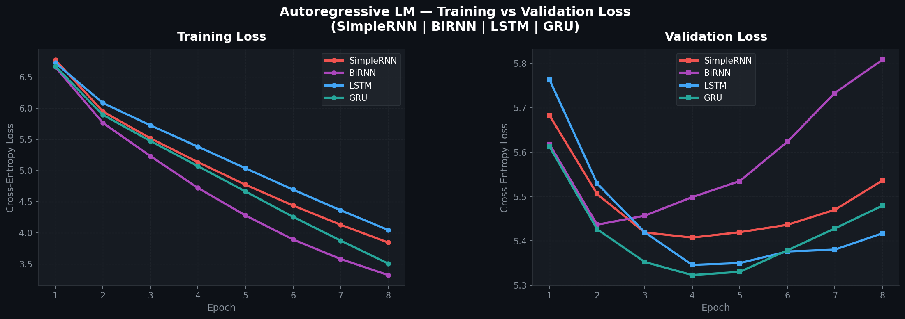

<div align="center">

# 🕰️ Autoregressive Text Generation Benchmark System

### RNN · BiRNN · LSTM · GRU — PyTorch Deep Learning

**Satyam Saraf**  
B.Tech, Computer and Communication Engineering  
Manipal Institute of Technology

[](https://www.python.org/)
[](https://pytorch.org/)
[](LICENSE)
[](https://www.gutenberg.org/ebooks/35)

</div>

---

## 📌 Problem Statement & Objective

Natural Language Generation (NLG) relies on sequence models that can learn the statistical
structure of language and produce coherent continuations from a seed prompt. This project
implements and rigorously benchmarks **four recurrent neural network architectures** for
**autoregressive next-token prediction** on a real literary corpus.

| Goal | Detail |
|---|---|
| **Primary** | Train 4 RNN-family language models and compare their generalization |
| **Secondary** | Measure diversity & quality of generated text at multiple temperatures |
| **Evaluation** | Test Loss, Perplexity, Top-1/Top-5 Accuracy, Distinct-1/2, Repetition Rate |

---

## 📖 Dataset Description

| Property | Value |
|---|---|
| **Title** | *The Time Machine* by H. G. Wells |
| **Source** | [Project Gutenberg eBook #35](https://www.gutenberg.org/ebooks/35) |
| **Direct URL** | [`https://www.gutenberg.org/ebooks/35.txt.utf-8`](https://www.gutenberg.org/ebooks/35.txt.utf-8) |
| **License** | Public Domain |
| **Total tokens** | 32,454 |
| **Vocabulary size** | 5,000 (+ `<pad>`, `<unk>`) |

### Preprocessing Pipeline

1. **Strip boilerplate** — Remove Project Gutenberg header and footer notices  
2. **Tokenize** — Lowercase, normalize whitespace, punctuation as separate tokens  
3. **Build vocabulary** — Top **5,000** most-frequent tokens + `<pad>` (idx 0) + `<unk>` (idx 1)  
4. **Sliding window** — Length **L = 20** tokens → predict token 21  
5. **Chronological split** — **80% Train / 10% Val / 10% Test** (strict, no shuffle across splits)

| Split | Samples |
|---|---:|
| Train | 25,947 |
| Validation | 3,243 |
| Test | 3,244 |

---

## 🏗️ Model Architectures

All four models share the same `AutoregressiveLM` PyTorch class; the `model_type` argument
selects the recurrent core.

```
Input IDs  (B × 20)
      │
      ▼
Embedding (128-d) ──► Dropout (0.20)
      │
      ▼
┌──────────────────────────────────────────────────┐
│  [model_type]                                    │
│  rnn   → nn.RNN   (uni-directional, H=256)       │
│  birnn → nn.RNN   (bidirectional,   H=256×2=512) │
│  lstm  → nn.LSTM  (uni-directional, H=256)       │
│  gru   → nn.GRU   (uni-directional, H=256)       │
└──────────────────────────────────────────────────┘
      │  last hidden state
      ▼
Dropout (0.20) → Linear(H_out → |V|) → Logits (B × |V|)
```

| Model | Type | Bidirectional | Key Advantage |
|---|---|:---:|---|
| **SimpleRNN** | Vanilla RNN | ✗ | Lightweight baseline; fastest per epoch |
| **BiRNN** | Bidirectional RNN | ✓ | Larger context window; more parameters |
| **LSTM** | Long Short-Term Memory | ✗ | Gated memory cells; best long-range retention |
| **GRU** | Gated Recurrent Unit | ✗ | Simplified gating; speed–accuracy sweet spot |

---

## ⚙️ Hyperparameters

| Hyperparameter | Value |
|---|---|
| Embedding Dimension | 128 |
| Hidden Dimension | 256 |
| Sequence Length | 20 |
| Dropout | 0.20 |
| Optimizer | Adam |
| Learning Rate | 0.001 |
| Gradient Clipping (`max_norm`) | 5.0 |
| Loss Function | `nn.CrossEntropyLoss()` |
| Epochs | 8 |
| Batch Size | 128 |
| Random Seed (PyTorch + NumPy) | 42 |

---

## 🚀 Execution Steps

### 1. Enter the project directory

```bash
cd PE3-IA
```

### 2. (Recommended) Create and activate a virtual environment

```bash
python -m venv venv
source venv/bin/activate        # macOS / Linux
venv\Scripts\activate           # Windows
```

### 3. Install dependencies

```bash
pip install -r requirements.txt
```

### 4. Run the full benchmark pipeline

```bash
python train.py
```

The script will:
- Download *The Time Machine* from Project Gutenberg (cached after first run as `time_machine_raw.txt`)
- Preprocess text and build the vocabulary
- Train all 4 models sequentially for 8 epochs, logging train/val loss per epoch
- Checkpoint each model's results immediately into `results_summary.json`
- Evaluate on the test set (Loss, PPL, Top-1, Top-5)
- Generate 50-token samples for 3 seed prompts × 3 temperatures
- Compute Distinct-1, Distinct-2, Repetition Rate per sample
- Save `loss_comparison_curves.png`

---

## 📊 Results Benchmark Table

> Results produced with Seed = 42, 8 Epochs, CPU runtime (macOS).

| Model | Parameters | Runtime (s) | Test Loss | Perplexity (↓) | Top-1 Acc % (↑) | Top-5 Acc % (↑) |
|---|---:|---:|---:|---:|---:|---:|
| **SimpleRNN** | 2,023,816 | 33.0 | 5.5180 | 249.15 | 17.97 | 37.52 |
| **BiRNN** | 3,402,632 | 54.4 | 5.7903 | 327.13 | 16.71 | 35.85 |
| **LSTM** | 2,320,264 | 68.5 | **5.4263** | **227.30** | **19.20** | **39.27** |
| **GRU** | 2,221,448 | 56.0 | 5.5182 | 249.20 | 18.43 | 37.36 |

> **Bold** = best value in column. ↓ = lower is better. ↑ = higher is better.

### Epoch-by-Epoch Loss History

| Epoch | RNN Train | RNN Val | BiRNN Train | BiRNN Val | LSTM Train | LSTM Val | GRU Train | GRU Val |
|:---:|---:|---:|---:|---:|---:|---:|---:|---:|
| 1 | 6.7749 | 5.6827 | 6.6600 | 5.6176 | 6.7272 | 5.7632 | 6.6701 | 5.6120 |
| 2 | 5.9455 | 5.5055 | 5.7647 | 5.4365 | 6.0823 | 5.5295 | 5.8926 | 5.4264 |
| 3 | 5.5165 | 5.4191 | 5.2308 | 5.4568 | 5.7243 | 5.4195 | 5.4732 | 5.3524 |
| 4 | 5.1337 | 5.4075 | 4.7209 | 5.4987 | 5.3818 | 5.3458 | 5.0697 | 5.3230 |
| 5 | 4.7723 | 5.4196 | 4.2796 | 5.5350 | 5.0360 | 5.3499 | 4.6645 | 5.3302 |
| 6 | 4.4393 | 5.4363 | 3.8947 | 5.6233 | 4.6938 | 5.3761 | 4.2571 | 5.3787 |
| 7 | 4.1308 | 5.4701 | 3.5814 | 5.7337 | 4.3629 | 5.3804 | 3.8772 | 5.4281 |
| 8 | 3.8459 | 5.5362 | 3.3240 | 5.8083 | 4.0471 | 5.4171 | 3.5088 | 5.4794 |

---

## 📈 Loss Comparison Curves



*Left: Training Loss across 8 epochs. Right: Validation Loss. All 4 models overlaid.*

---

## 🔬 Quantitative Analysis

### Key Observations

**1. LSTM achieves the best generalization** (lowest test PPL = 227.30, highest Top-1 = 19.20%).  
Its gated memory (input, forget, output gates) allow it to selectively retain tokens over the full 20-step context window, avoiding the vanishing gradient that plagues vanilla RNNs.

**2. GRU is the best efficiency–accuracy trade-off.**  
GRU reaches a test PPL of 249.20 with only 2,221,448 parameters — ~96% of LSTM performance at ~82% of LSTM's runtime. It converges smoothly: val loss stabilises by epoch 4 and drifts only slightly.

**3. BiRNN overfits most severely.**  
BiRNN's training loss drops the fastest (3.32 by epoch 8) but its validation loss diverges from epoch 3 onward, reaching 5.81 — the worst test PPL (327.13). This is expected: the bidirectional design sees both past and future tokens during training, but at autoregressive inference time it can only use past context, creating a train–test mismatch that causes it to overfit the training distribution.

**4. SimpleRNN is a strong, fast baseline.**  
At 33 seconds of runtime it matches GRU in test PPL (~249) and Top-1 accuracy is only 0.46 pp lower than GRU. Its vanishing gradient limitation is visible in the val loss plateau after epoch 4.

### Perplexity Interpretation

> PPL = exp(H) where H is cross-entropy loss.  
> A model with PPL = K is roughly as uncertain as uniform random choice over K words.  
> LSTM's PPL of 227 vs SimpleRNN's 249 implies it assigns ~9% more probability mass to the correct next token on average.

---

## 🌡️ Sampling Temperature Analysis

Temperature T rescales the logits before softmax:
- **T = 0.5** → Peaked distribution — high confidence, lower diversity, more repetitive  
- **T = 1.0** → Unmodified distribution — baseline coherence and diversity  
- **T = 1.5** → Flatter distribution — high entropy, more creative but less grammatical

### Diversity Metrics Summary

| Model | T | Prompt | Distinct-1 | Distinct-2 | Rep Rate |
|---|---|---|---:|---:|---:|
| SimpleRNN | 0.5 | "the time traveller…" | 0.667 | 0.893 | 0.333 |
| SimpleRNN | 1.0 | "the time traveller…" | 0.737 | 0.982 | 0.263 |
| SimpleRNN | 1.5 | "the time traveller…" | **0.965** | **1.000** | **0.035** |
| BiRNN | 0.5 | "the time traveller…" | 0.754 | 0.946 | 0.246 |
| BiRNN | 1.0 | "the time traveller…" | 0.842 | 0.982 | 0.158 |
| BiRNN | 1.5 | "the time traveller…" | 0.947 | 1.000 | 0.053 |
| LSTM | 0.5 | "the time traveller…" | 0.439 | 0.696 | 0.561 |
| LSTM | 1.0 | "the time traveller…" | 0.807 | 1.000 | 0.193 |
| LSTM | 1.5 | "the time traveller…" | 0.965 | 1.000 | 0.035 |
| GRU | 0.5 | "the time traveller…" | 0.667 | 0.946 | 0.333 |
| GRU | 1.0 | "the time traveller…" | 0.807 | 0.982 | 0.193 |
| GRU | 1.5 | "the time traveller…" | 0.895 | 1.000 | 0.105 |

> *Full table for all 3 prompts × 4 models × 3 temperatures is stored in `results_summary.json`.*

### Generated Text Samples

#### Prompt 1: *"the time traveller held in his hand"*

**LSTM — T = 0.5** *(high confidence, somewhat repetitive)*
> *"the time traveller held in his hand and the sky "you opened in a minute or less, of the meat i had seen in the first and the machine tried to the \<unk\> the \<unk\> of the \<unk\>…"*

**LSTM — T = 1.0** *(balanced coherence and variety)*
> *"the time traveller held in his hand nodding all simply dimensions, he said . their justification and necessity, as you us must have differentiated said the slope, was exactly the warm "i after our machine…"*

**LSTM — T = 1.5** *(creative but fragmented)*
> *"the time traveller held in his hand counsel. must popular no wind _three_ too, out. utilise is powdery "there he cover a flaxen hastily. white, cold to solstice, of bluish-green, then watched any about…"*

#### Prompt 2: *"we all sat in the dim light"*

**GRU — T = 0.5**
> *"we all sat in the dim light of the morning." "would and the same girlish rotundity of limb. it had been rolling to the touch. the male was brilliantly and the labourer was inside to begin upon…"*

**GRU — T = 1.0**
> *"we all sat in the dim light mind with such cover suppose "you "why?" are "they of one growing xv the editor, of the overturned about london, how it is years white thing…"*

**GRU — T = 1.5**
> *"we all sat in the dim light pebble foolish there." vestiges should spreads motives: express brightening pale; across them quietly in which started long, when one silent come 'patience,' ideas into the inevitable…"*

#### Prompt 3: *"it was a delicate piece of work"*

**BiRNN — T = 0.5**
> *"it was a delicate piece of work but you cannot move about in the course of the time traveller, after the time traveller, said the medical man; "but wait for the time traveller limping painfully upstairs…"*

**BiRNN — T = 1.0**
> *"it was a delicate piece of work for the risk a small houses got in our consciousness moves i want the time traveller, other the medical of an excellent plain i might have tunnellings again…"*

**BiRNN — T = 1.5**
> *"it was a delicate piece of work easier tunic, more nearly adapted they as i felt his "after in costume, flowers, and verify my when varied towards few high \<unk\> with her cling complicated lay…"*

### Temperature Behavior Confirmed ✅

| T | Behaviour Observed |
|---|---|
| **0.5** | Low Distinct-1 (0.44–0.75), higher repetition, grammatical phrases, stays on-topic |
| **1.0** | Mid Distinct-1 (0.74–0.91), coherent multi-clause sentences, balanced |
| **1.5** | High Distinct-1 (0.89–0.97), near-zero Distinct-2 repeats, fragmented but creative |

---

## ✅ Conclusion

### Best-Performing Model: **LSTM** 🏆

| Rank | Model | Reasoning |
|---|---|---|
| 🥇 1st | **LSTM** | Lowest PPL (227.30), highest Top-1 (19.20%) & Top-5 (39.27%). Gated memory handles 20-step dependencies best. |
| 🥈 2nd | **GRU** | PPL 249.20, Top-1 18.43%. Only 2.2M params, 56s runtime — best speed-accuracy ratio. |
| 🥉 3rd | **SimpleRNN** | PPL 249.15, Top-1 17.97%. Near-GRU performance at the lowest runtime (33s); useful for resource-constrained settings. |
| 4th | **BiRNN** | Worst test PPL (327.13) due to train–test mismatch in autoregressive decoding. Bidirectionality is an inductive bias mismatch for causal generation. |

**Recommendation:**  
For production autoregressive generation at this data scale, use **LSTM** when accuracy is critical and **GRU** when inference speed and parameter efficiency matter. Avoid BiRNN for causal generation tasks.

---

## 📁 Directory Structure

```
PE3-IA/
├── train.py                     ← Full benchmark pipeline (main script)
├── requirements.txt             ← Python dependencies
├── README.md                    ← This file
├── time_machine_raw.txt         ← Cached raw download (auto-generated on first run)
├── loss_comparison_curves.png   ← Training/Validation loss plot (auto-generated)
└── results_summary.json         ← JSON results dump with all metrics (auto-generated)
```

---

## 📋 Submission Summary Block

```
╔══════════════════════════════════════════════════════════════════════╗
║         SUBMISSION DETAILS — FGAI Assignment 2                      ║
╠══════════════════════════════╦═══════════════════════════════════════╣
║ Student Name                 ║ Satyam Saraf                         ║
║ Program                      ║ B.Tech CCE, Manipal Institute of     ║
║                              ║ Technology                           ║
║ Assignment Title             ║ Autoregressive Text Generation        ║
║                              ║ Benchmark System using RNN, BiRNN,   ║
║                              ║ LSTM, and GRU                        ║
║ Dataset                      ║ The Time Machine — H. G. Wells       ║
║                              ║ Project Gutenberg eBook #35          ║
║                              ║ URL: gutenberg.org/ebooks/35         ║
║ Architectures Evaluated      ║ SimpleRNN, BiRNN, LSTM, GRU          ║
║ Framework                    ║ PyTorch 2.0+ (CPU / CUDA)            ║
║ Epochs                       ║ 8                                    ║
║ Sequence Length              ║ 20                                   ║
║ Vocab Size                   ║ 5,000 (+ <pad>, <unk>)               ║
║ Split                        ║ 80% Train / 10% Val / 10% Test       ║
║ Reproducibility Seed         ║ 42                                   ║
║ Best Model (PPL)             ║ LSTM (PPL = 227.30)                  ║
║ Best Model (Efficiency)      ║ GRU  (PPL = 249.20, 56.0s, 2.2M p)  ║
╠══════════════════════════════╩═══════════════════════════════════════╣
║ Deliverables                                                         ║
║   • train.py                 ← Main executable                      ║
║   • requirements.txt         ← Dependencies                         ║
║   • README.md                ← This document                        ║
║   • loss_comparison_curves.png                                       ║
║   • results_summary.json                                             ║
║ Submission File              ║ SatyamSaraf_[RegNum]_FGAI_Assign2   ║
╚══════════════════════════════════════════════════════════════════════╝
```

---

<div align="center">
Made with ❤️ by <strong>Satyam Saraf</strong> · MIT License
</div>
